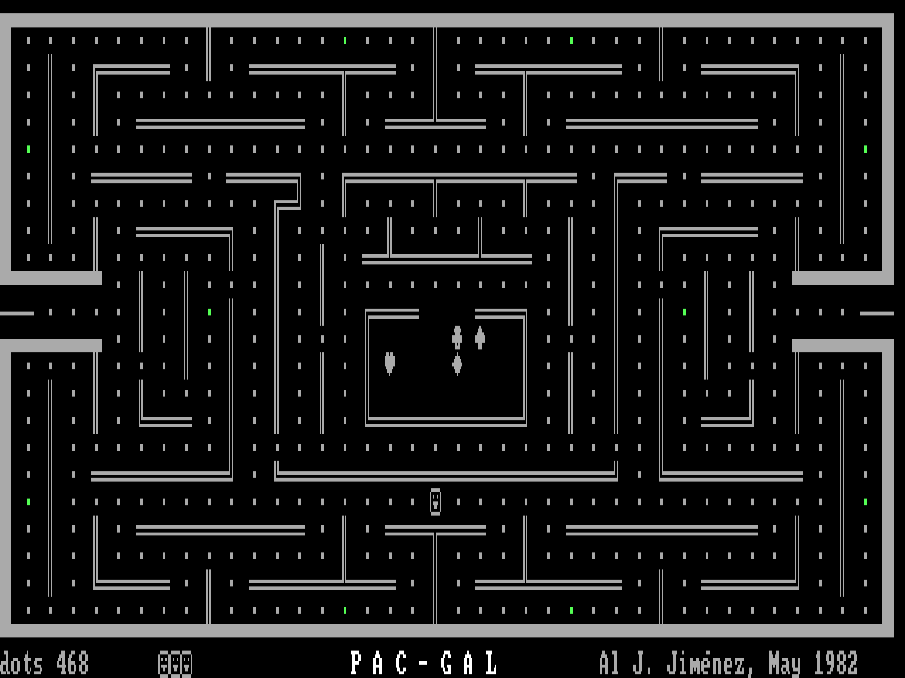

# Pac-Gal for MS-DOS
An analysis of the May 1982 game for IBM-PC by Al. J Jiménez.  It's a simple ASCII game, and I really enjoyed playing it "back in the day".  It's the gameplay, never the graphics.<br>



The game was originally written in [PC-BASIC](https://robhagemans.github.io/pcbasic/) and compiled.  An approximation of the original PC-BASIC source code has been generated.<br>

The aim of this project is to recreate it for the modern Mac so I don't need to worry about praying to the Omnissiah to keep my original IBM computers running.<br>

Of course, you could also run it in the cross-platform PC-BASIC implementation linked above ...<br>

## Bugs
There appears to be one interesting bug.  The variable ```P``` is the ghost randomness variable and is initialised to 0 in line 460:<br>

```460 LV=3:DT=468:P=0```

It is modified in a few places, but the value never changes from 0:<br>

```
1350 IF DT<50 THEN P=P*.5

3050 IF DT>300 THEN IF P<.1 THEN P=P+P

3550 P=P*.5
```

- Line 1350: Each step once fewer than 50 dots are left, ```P``` is halved (ghosts get harder)
- Line 3050: You die while more than 300 dots are left and P < 0.1 then ```P``` is doubled (ghosts get easier)
- Line 3550: You eat a ghost then ```P``` is halved (ghosts get harder)

A value of 0.25 means there is a 25% change that a ghost will "wander off" rather than chase you ... a value of 0 means the ghost will always chase you.<br>

There are two issues here:<br>
- The fairly-standard use of DEFINT A-Z which defines all variables as integers which means it can never be be 0.5 or 0.1: ```90 DEFINT A-Z```
- It is never changed from value 0 and thus the changes to the value never have any effect

Of course, this could be by design ... after testing, Al found no need to use the ghost randomness variable.<br>

This could be fixed in the original PC-BASIC source with these changes:<br>

```
95 DEFSNG P

460 LV=3:DT=468:P=.25
```

