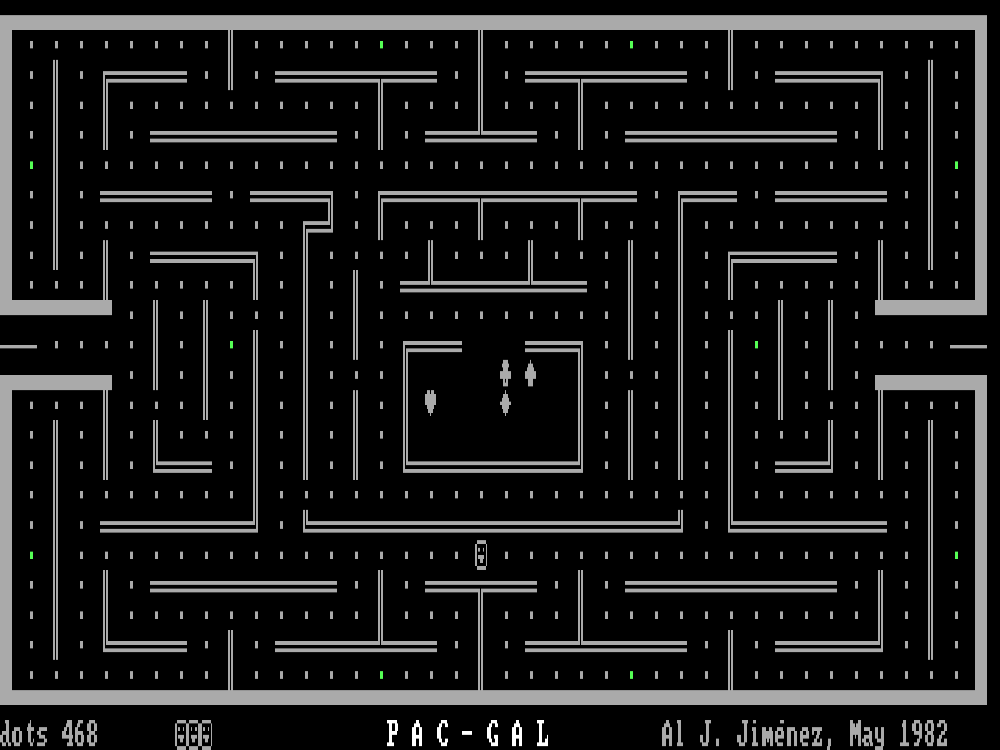

# PAC-GAL (1982), recreated in C with SDL3



A faithful, windowed recreation of **PAC-GAL** by Al J. Jiménez (May 1982), the IBM PC text-mode Pac-Man clone. It's written in portable C99 with SDL3 and builds on macOS, Linux and Windows.

The game logic is a line-by-line port of the original program, reconstructed by disassembling `Original/Pac-gal.exe` (see `../Analysis/`). It was checked against the real EXE running in an emulator. With `--original` rules and the same inputs and random numbers, the port's game state **and every character and colour on the 80×25 screen** match the original on every step. Four scripted runs of 1,500 steps each were compared, including dozens of deaths and several ghosts being eaten.

## Building

You need CMake 3.16+ and a C compiler. SDL3 is used if it's already installed; if it isn't, CMake downloads and builds it for you, which needs Git and an internet connection the first time.

### macOS

```sh
brew install cmake sdl3           # sdl3 is optional, see above
cmake -S . -B build -DCMAKE_BUILD_TYPE=Release -DCMAKE_PREFIX_PATH="$(brew --prefix)"
cmake --build build
open build/PAC-GAL.app
```

### Linux

```sh
# Debian/Ubuntu 25.04+: sudo apt install cmake build-essential libsdl3-dev
# Fedora:               sudo dnf install cmake gcc SDL3-devel
# Arch:                 sudo pacman -S cmake sdl3
cmake -S . -B build -DCMAKE_BUILD_TYPE=Release
cmake --build build
./build/PAC-GAL
```

If your distribution doesn't package SDL3 yet, just leave it out and CMake builds it. In that case you need SDL's own build dependencies (X11 and/or Wayland, ALSA or PulseAudio development headers) for a working window and sound.

### Windows (Visual Studio 2022 or MinGW)

```bat
cmake -S . -B build
cmake --build build --config Release
build\Release\PAC-GAL.exe
```

SDL3 is fetched and linked statically, so the EXE runs on its own. If you use vcpkg, `vcpkg install sdl3` and pass the vcpkg toolchain file instead.

### Tests

```sh
ctest --test-dir build
```

The tests cover the board layout, tunnel, fright times, eating ghosts, deaths, board clear and the PLAY parser. A soak test also plays thousands of games in simulated real time to check that nothing stalls. They need no SDL or display.

To repeat the comparison against the original EXE (needs Python 3 with `unicorn` and `capstone`):

```sh
python3 tools/compare_trace.py ../Original/Pac-gal.exe ../Analysis/tools build/pacgal_trace 1500 -1 6 594
```

## Playing

As in 1982, the game first asks **How fast (0-30000)?**. That number was a busy-wait loop on the original. Here each step takes `60 ms + speed × 0.06 ms`, an estimate of a 4.77 MHz IBM PC: 0 is about 16 steps a second, 1000 about 8.

| Key | Action |
|---|---|
| Arrow keys (or keypad 8/4/6/2) | steer Pac-Gal (the turn is remembered until it's possible) |
| `y` / `Y` / `n` | answer "Play again???" (only lowercase `n` quits, like the original) |
| F2 | switch between 4:3 CRT shape and square pixels |
| F3 | sound on/off |
| F11 or Alt+Enter | full screen |
| Esc | quit |

A "How fast" value of about 500–750 plays well.

Command-line options: `--speed N` (skip the prompt), `--faithful-clock`, `--square-pixels`, `--fullscreen`, `--mute`, `--help`.

### One change from 1982: longer power pellets

In the original, a power pellet frightens the ghosts for only `(dots/5 + 20) / lives²` ghost moves. That's 13 moves, about 1½ seconds, on a full board with 3 lives, and the ghosts keep chasing you while they're blue. So by default the remake makes **power pellets last at least 6 seconds** at any speed. Where the original formula gives longer, for example on your last life, that longer time is kept.

| Option | Effect |
|---|---|
| `--fright-min S` | power pellets last at least S seconds (default 6) |
| `--original` | exact 1982 rules, including the short power pellets |
| `--fright X` | multiply the original fright time by X |
| `--scared-ghosts` | frightened ghosts run away from you instead of chasing |
| `--wander P` | each ghost move has chance P (0–1) of wandering instead of chasing. This turns on the author's difficulty variable, which the original never set. |
| `--easy` | `--wander 0.3 --fright 2 --scared-ghosts` |

### Faithful to a fault

Apart from the power-pellet time, the original's quirks are kept, because they are part of how it plays:

- The ghosts always chase. The "randomness" variable is always 0.
- Frightened ghosts still chase you, and a ghost crossing a power pellet removes its power.
- Eating a ghost gives a life back (up to 3), and can make Pac-Gal hop onto the ghost's square.
- Ghosts get an extra move per step for every 3 minutes since your last death or ghost eaten.
- There's no score, and clearing the board ends the game.

One thing is fixed by default: the original clock counted hours as 360 seconds. Pass `--faithful-clock` to get that back, including its effect of resetting the ghost speed-up on the hour and making the "You did it!!!" pause hang for most of an hour if it straddles one.

## How it is put together

| File | Purpose |
|---|---|
| `src/game.c` | the game, ported from `../Analysis/PACGAL_reconstructed.bas` (line numbers in comments). Uses the screen as its map, like the original. |
| `src/screen.c` | 80×25 character + attribute buffer with BASIC-style `LOCATE`, `COLOR`, `PRINT` and `SCREEN()` |
| `src/sound.c` | IBM BASIC `PLAY` (MML) and `SOUND`, played in the background as a square wave like the PC speaker. It's generated on SDL's audio thread, so it doesn't depend on the frame rate, with 1 ms ramps so notes don't click. |
| `src/main.c` | SDL3 window, rendering (8×8 CGA font with doubled rows, CGA palette, blinking), keyboard and audio |
| `src/font_cp437.h` | CP437 8×8 font, generated by `tools/make_font.py` |
| `tests/` | logic tests and the trace tool used for the comparison |

Rendering draws the text screen into a 640×400 image, exactly what a CGA card shows in 80-column text mode. It's then scaled with a "sharp bilinear" filter (nearest-neighbour up to a whole multiple, then smooth) so it stays crisp in any window size, at 4:3 by default.

## Credits and licences

- **PAC-GAL** © 1982 Al J. Jiménez. This is an independent recreation for preservation and study.
- **Font:** glyphs from Daniel Hepper's `font8x8` (public domain), derived from Marcel Sondaar's public-domain IBM-VGA-style font. The smiley, card-suit and dot glyphs were drawn for this project.
- **SDL3:** zlib licence, https://libsdl.org
